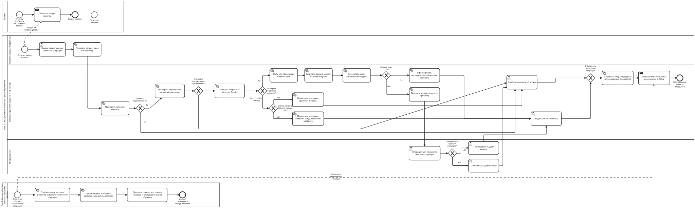
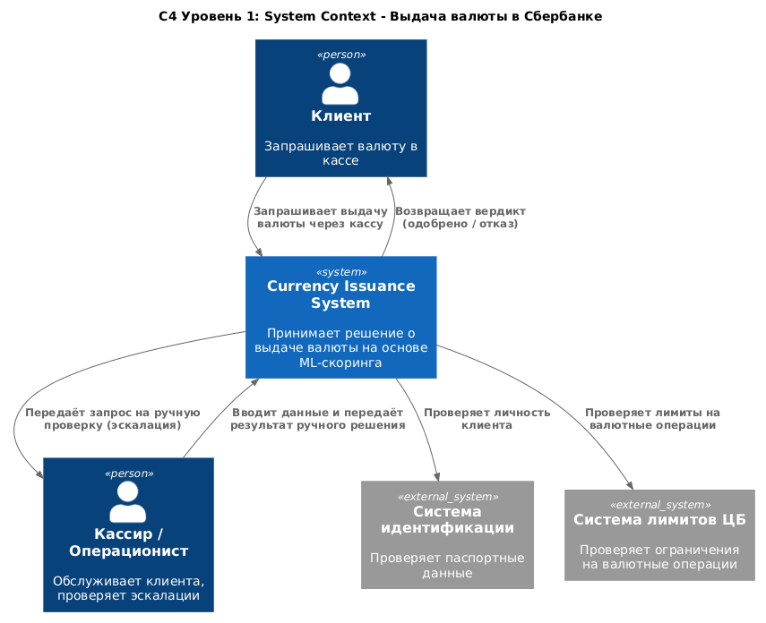
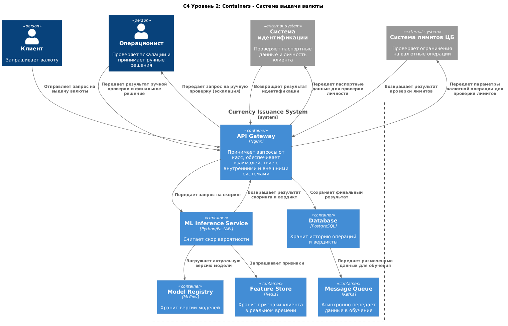
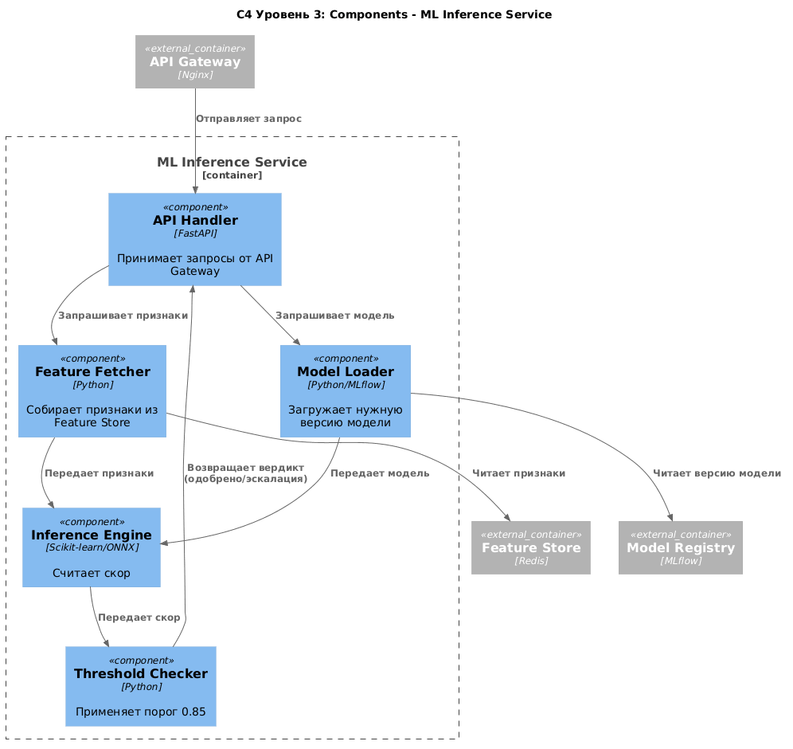

# ml-system-architecture-hw6
# Архитектура ML-системы: Выдача валюты в кассе Сбербанка

## 1. Компания и процесс
- **Компания:** ПАО Сбербанк
- **Процесс:** Автоматизация принятия решения о выдаче наличной валюты в кассе банка.
- **Результат:** Клиент получает валюту сразу в кассе (одобрение) или запрос отправляется операционисту на ручную проверку.

## 2. Задача модели
- **Вход:** ID клиента, сумма запроса, валюта, время суток, история предыдущих операций за 180 дней.
- **Выход:** Скор от 0.0 до 1.0.
- **Бизнес-логика:** Модель оценивает вероятность того, что операция по выдаче наличной валюты соответствует установленным критериям безопасности и не требует дополнительной проверки. На выходе формируется скор от 0 до 1. При значении не ниже 0.85 система передаёт решение на автоматическое одобрение, при меньшем значении направляет операцию операционисту.
- **Бизнес-результат:** Снижение времени обслуживания клиента в кассе за счет автоматического одобрения надежных операций, а также снижение операционных рисков за счет эскалации подозрительных транзакций

## 3. Границы работы
- **Входит в схемы:** Процесс от запроса клиента в кассе до получения ответа системой кассира. Внутреннее устройство ML-сервиса.
- **Сознательно оставлено за рамками:** Процесс найма кассиров, физическая инкассация валюты. Обучение модели не входит в моделируемый бизнес-процесс. В архитектуре показана только передача результатов операций в контур сбора обратной связи для последующего обучения.

## 4. Кто получает результат модели
- **Автоматическая система кассы (Терминал):** Получает вердикт (одобрено/отказ) и выводит его на экран.
- **Операционист (человек):** Получает эскалированный запрос с указанием причины (низкий скор) для ручной проверки.

## 5. Список допущений (Assumptions)
*Все, что не видно снаружи, но необходимо для работы схемы.*
1. **Порог отсечения (Threshold):** Установлен на уровне 0.85 (допущение, реальное значение неизвестно).
2. **Fallback-правило:** 
    - Технический сбой: Если ML-сервис недоступен (таймаут, ошибка 5xx), система применяет жесткое бизнес-правило: «Выдавать, если сумма < 50 000 руб. и клиент имеет статус VIP, иначе — отказ».
    - Низкая уверенность модели: Если ML-сервис доступен, но выдал скор < 0.85 (не прошел порог), система не отклоняет запрос автоматически, а эскалирует его операционисту для ручной проверки. Операционист принимает финальное решение.
3. **Хранилище признаков:** Для быстрого доступа к истории операций используется Feature Store на базе Redis.
4. **Реестр моделей:** Версии моделей хранятся в MLflow (или S3).
5. **Обратная связь:** Разметка (одобрено/отказ) собирается из финального статуса операции в базе данных и асинхронно передается в пайплайн обучения.

## 6. Источники и метод реконструкции

### Использованные источники

1. Официальный сайт Сбербанка — информация о банковских услугах и обслуживании физических лиц: https://www.sberbank.ru/
2. Официальная документация Redis — описание возможностей хранения данных в оперативной памяти: https://redis.io/docs/
3. Статья "Учёные Сбера создали фундаментальную ИИ-модель для решения финансовых задач" https://www.sberbank.ru/ru/sberpress/analitika_issledovaniya/article?blockID=8395751f-c0a8-4eaf-9b4c-edb74c4ff38d&lang=ru&newsID=6922d4a5-2f3e-4289-8928-46adb4ab5eb1&regionID=16&type=NEWS&utm_source=chatgpt.com

### Авторская реконструкция

Публичная информация не раскрывает внутреннюю архитектуру системы принятия решений о выдаче наличной валюты в кассах Сбербанка.

Поэтому схема представляет собой авторскую гипотетическую архитектуру ML-системы, разработанную для демонстрации возможного процесса автоматизированной оценки операций.

Названия внутренних сервисов, используемые технологии, состав признаков, порог принятия решения, правила резервной обработки и механизм обратной связи являются допущениями автора и не утверждают, что именно такая архитектура используется в Сбербанке.

## 7. Имена файлов и чем открыть
- `diagrams/bpmn_process.bpmn` — BPMN XML.
- `diagrams/c4_context.puml` — PlantUML.
- `diagrams/c4_containers.puml` — PlantUML.
- `diagrams/c4_components.puml` — PlantUML.
- `images/*.png` — сгенерированные картинки.
- `images/bpmn_process.svg` — векторная картинка BPMN-схемы.

## 8. Соответствие нотаций (BPMN <-> C4)
| Этап BPMN | Контейнер C4 | Назначение |
|---|---|---|
| Приём запроса на выдачу валюты | API Gateway | Получение и маршрутизация запроса |
| Проверка личности клиента | Внешняя система идентификации через API Gateway | Проверка паспортных данных |
| Проверка ограничений на операцию | Внешняя система лимитов ЦБ через API Gateway | Проверка допустимости операции |
| Получение признаков и расчёт ML-оценки | ML Inference Service | Вызов модели и получение скора |
| Получение признаков клиента | Feature Store | Предоставление данных для модели |
| Загрузка версии модели | Model Registry | Предоставление актуальной версии модели |
| Формирование вердикта | ML Inference Service | Проверка порога и формирование результата |
| Сохранение результата операции | Database | Фиксация итогового решения |
| Передача данных для последующего обучения | Message Queue | Асинхронная передача данных |
| Ручная проверка запроса | API Gateway и операционист | Передача запроса на эскалацию и получение решения |

## 9. Визуализация архитектуры

### BPMN: Процесс выдачи валюты

### C4 Level 1: System Context

### C4 Level 2: Containers

### C4 Level 3: Components
